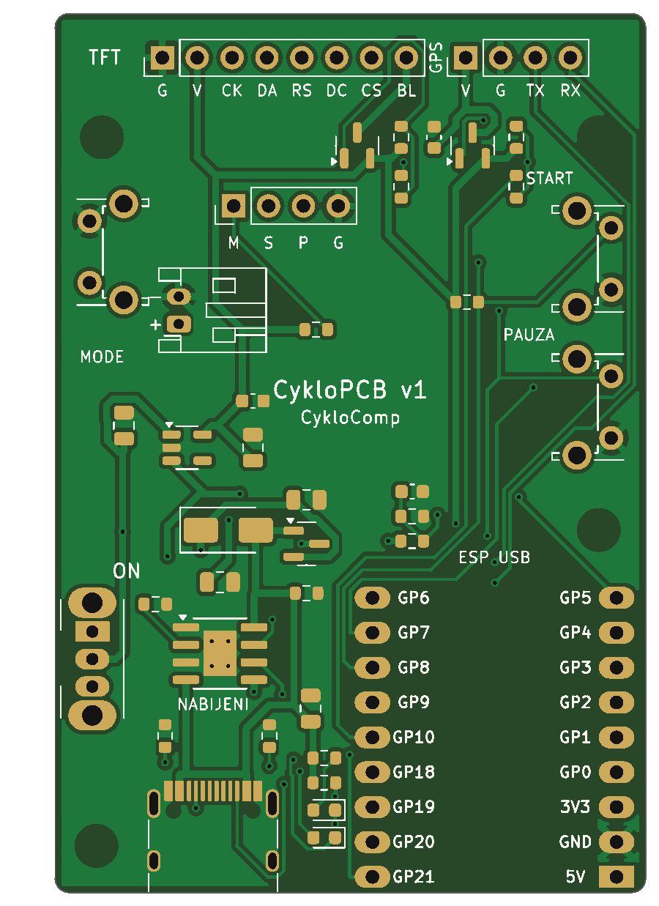
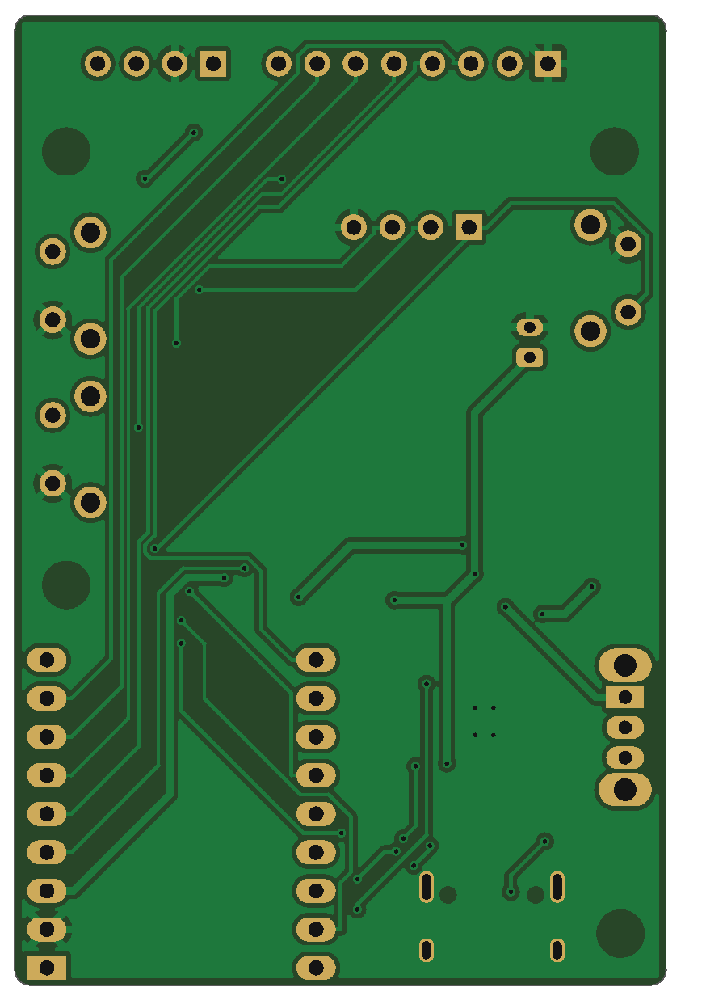
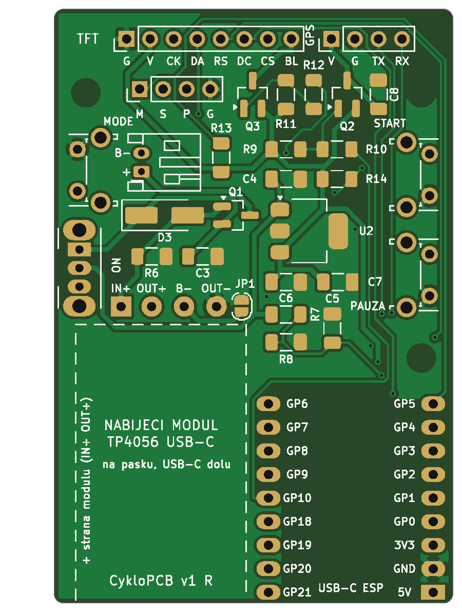
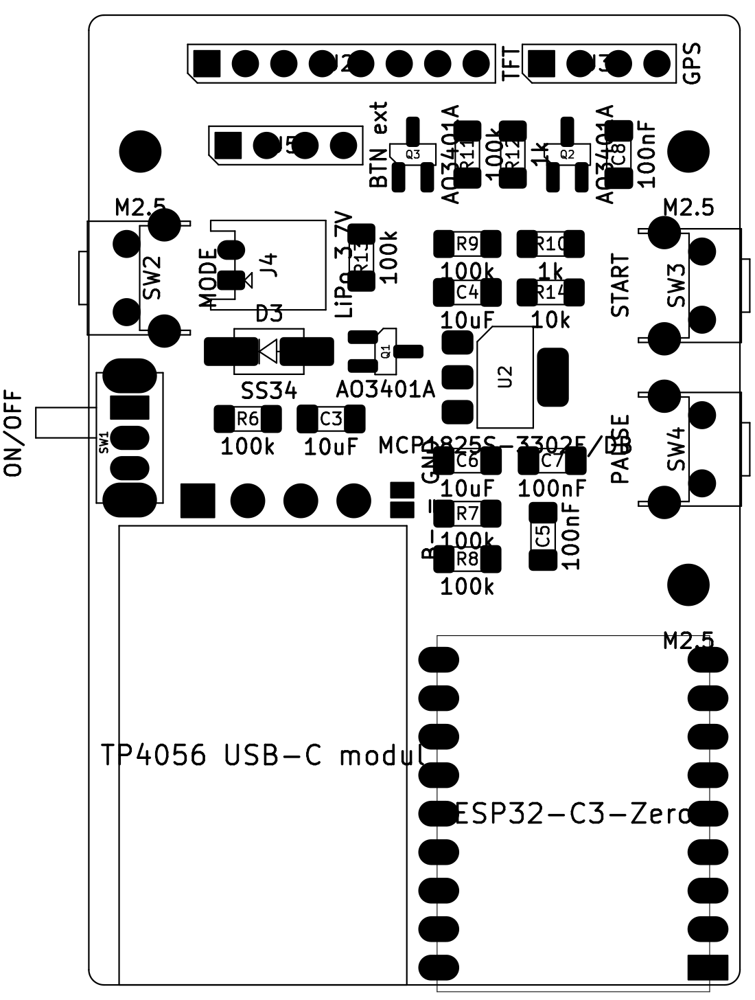

# CykloPCB v1 – plošný spoj pro CykloComp

Nosná deska 43 × 64 mm, na kterou se připájí **Waveshare ESP32-C3-Zero**,
připojí **displej**, **GPS** a **Li-Po baterie**. Řeší všechno, co na
nepájivém poli chybělo: nabíjení přes USB-C s „power-path“, vypínač,
3,3 V stabilizátor, měření baterie, vypínání GPS a podsvícení (pro spánek)
a tři boční tlačítka.

| Horní strana | Spodní strana |
|---|---|
|  |  |

Schéma: [`schema_zapojeni.svg`](schema_zapojeni.svg) ([PNG](schema_zapojeni.png))

**Dvě varianty – vyber si:**

| | **CykloPCB v1** (JLC osadí) | **CykloPCB v1 R** (všechno pájíš sám) |
|---|---|---|
| Objednáš | desku + osazení SMD u JLCPCB | jen holou desku (~100–250 Kč za 5 ks vč. dopravy) |
| Součástky | 0603, USB-C a TP4056 přímo na desce | velké **1206**, SOT-223, SMA + **tvůj modul TP4056 USB-C** |
| Pájení | jen THT (tlačítka, konektory, ESP) | všechno, ale nic malinkého – zvládne začátečník |
| Soubory | `build/` | `build_rucni/` → [návod níž](#varianta-pro-ruční-pájení--cyklopcb-v1-r) |

Firmware je pro obě stejný (`BOARD_PROFILE BOARD_CYKLOPCB_V1`), krabička má
přepínač `pcb_variant`.

## Co je na desce

| Blok | Součástky | Proč |
|---|---|---|
| Nabíjení | USB-C (J1) + **TP4056** (U1), 600 mA, LED červená = nabíjí, zelená = nabito | stejný čip jako tvůj modul, ale… |
| **Load-sharing (power-path)** | Schottky D3 + P-MOSFET Q1 | …když je zapojené USB, CykloComp jede z USB a baterie se jen nabíjí. Modul TP4056 tohle neumí → při nabíjení za jízdy (powerbanka) baterii trvale „dobíjí“ a nikdy neukončí nabíjení. |
| Vypínač | posuvný SW1 na boku | skutečně odpojí elektroniku (0 µA), nabíjení funguje i vypnuté |
| 3,3 V | **AP2112K-3.3** (U2), 600 mA, malý úbytek | baterie se využije až do ~3,4 V |
| Měření baterie | dělič 100k/100k → GPIO0 | % baterie na displeji i v appce, poznání USB nabíjení, vypnutí při vybití |
| Spínání GPS | P-MOSFET Q2 ← GPIO10 | GPS (~25 mA) se ve spánku úplně vypne |
| Podsvícení | P-MOSFET Q3 ← GPIO7 (PWM) | jas displeje + vypnutí ve spánku (displeje s pinem BLK) |
| Tlačítka | 3× úhlové tlačítko na hraně (MODE/START/PAUZA) + J5 pro externí vodotěsná | MODE umí probudit ESP z deep sleep (GPIO5) |

Zapojení ESP32-C3-Zero (pady číslované od USB):

| Pin modulu | Funkce | Pin modulu | Funkce |
|---|---|---|---|
| 5V | **nezapojeno** (USB modulu jen na programování) | GP21 | → RX GPS |
| GND | GND | GP20 | ← TX GPS |
| 3V3 | 3,3 V z desky | GP19, GP18 | – |
| GP0 | měření baterie | GP10 | zapnutí GPS |
| GP1–GP4 | TFT RST, DC, CS, SCLK | GP9 | tlačítko PAUZA (= BOOT) |
| GP5 | tlačítko MODE (probouzí) | GP8 | tlačítko START |
| | | GP7 / GP6 | podsvícení PWM / TFT MOSI |

> ⚠️ **Před objednáním zkontroluj** rozložení pinů svého modulu ESP32-C3-Zero
> proti potisku na desce (u každé plošky je napsané GPIO). Vychází z
> dokumentace Waveshare (pady 1–3 = 5V/GND/3V3, pady 4–14 = GP0–GP10). Řady pinů
> jsou na footprintu 17,78 mm od sebe a plošky jsou prodloužené, takže modul jde
> připájet přes kolíkovou lištu i naplocho za půlotvory na okraji.

## Jak objednat u JLCPCB (orientačně 30–60 € za 5 desek, z toho 2 osazené, vč. dopravy a DPH)

1. Na <https://jlcpcb.com> → **Order now** → **Add gerber file** →
   nahraj `build/CykloPCB_v1_gerber_JLCPCB.zip`.
2. Parametry nech výchozí: 2 vrstvy, 1,6 mm, HASL (lead free je hezčí),
   barva libovolná (zelená je nejlevnější a nejrychlejší), 5 ks.
3. Zapni **PCB Assembly** → *Economic*, **Top side**, počet osazených 2 nebo 5.
4. Nahraj **BOM** `build/CykloPCB_v1_BOM_JLCPCB.csv` a **CPL**
   `build/CykloPCB_v1_CPL_JLCPCB.csv`.
5. V náhledu osazení **zkontroluj otočení** součástek (hlavně TP4056 – tečka =
   pin 1, MOSFETy, LED a USB-C). Když něco sedí natočené, JLC ho otočí
   tlačítkem *Rotate* přímo v náhledu. Typicky bývá potřeba otočit USB-C a SOT-23.
6. Pokud některá součástka není skladem, JLC nabídne náhradu (rezistory /
   kondenzátory klidně, u TP4056/AP2112K vyber stejný čip jiného výrobce).

JLC osadí jen SMD součástky nahoře. **Ručně připájíš** (seznam
`build/CykloPCB_v1_rucni_osazeni.csv`):

| Pozice | Díl | Kde koupit |
|---|---|---|
| U3 | Waveshare ESP32-C3-Zero (máš) | – |
| SW1 | posuvný přepínač C&K OS102011MA1QN1 (úhlový, 2,54 mm) | TME, Mouser, AliExpress „OS102011MA1Q“ |
| SW2–SW4 | úhlové tlačítko 6×6 mm C&K PTS645VL31-2 LFS (nebo kompatibilní) | TME, Mouser |
| J4 | JST PH 2,0 mm 2pin horizontální (S2B-PH-K) | TME, AliExpress |
| J2, J3, J5 | kolíková lišta 2,54 mm (nebo rovnou připájet vodiče) | kdekoli |

## Postup oživení (důležité – v tomhle pořadí)

1. **Bez baterie a bez ESP**: připoj USB-C (NABÍJENÍ). Červená LED musí
   blikat/svítit (nabíječka bez baterie). Multimetrem: VSW ≈ 4,6 V (vypínač ON),
   3V3 = 3,3 V. Teprve pak dál.
2. **Zkontroluj polaritu baterie!** Čínské Li-Po s konektorem JST PH mívají
   prohozené kabely. Na desce je u J4 potisk **+** a **−**. Případně kabely
   v konektoru přehoď (jehlou nadzvedni západku).
3. Baterie **musí mít ochranný obvod (PCM)** – u 103450 bývá pod páskou na
   vývodech malá destička. Deska ochranu proti podvybití nemá (hlídá ji firmware
   + PCM v baterii).
4. Připájej ESP32-C3-Zero, tlačítka, vypínač, konektory.
5. Ve firmwaru nastav `#define BOARD_PROFILE BOARD_CYKLOPCB_V1`
   (v `firmware/CykloComp/CykloComp.ino`) a nahraj přes USB-C **na modulu ESP**.

## Varianta pro ruční pájení – CykloPCB v1 R

| Deska | Osazovací výkres (hodnoty součástek) |
|---|---|
|  |  |

Stejná velikost, displej, GPS, boční tlačítka a piny ESP jako v1 – místo USB-C
a nabíječky na desce se **nalepí tvůj modul TP4056 USB-C** a ostatní součástky
jsou velké (1206 = 3,2 × 1,6 mm, rozšířené plošky „HandSolder“).

Rozdíly proti v1 (a proti [schématu](schema_zapojeni.svg), které kreslí v1):

- **A1 = modul TP4056** místo J1, U1, R1–R5, C1, C2, D1, D2 (USB-C, nabíječka, LED).
- **J4 pin 2 = B-** (vede do modulu na jeho B-), ne GND. **JP1** = pájecí můstek B- ↔ GND.
- **U2 = MCP1825S-3302E/DB** v SOT-223 (1 VIN, 2 + chladicí ploška GND, 3 VOUT;
  500 mA, klidový proud ~120 µA) místo AP2112K.
- Jen **3 montážní díry** (H3 v rohu pod modulem odpadá), vypínač SW1, J4 a J5
  jsou jinde → krabička s `pcb_variant = "rucni"`.
- GND plošky SMD součástek mají tepelné můstky (jdou snadno zapájet).

**Objednání:** na JLCPCB nahraj jen `build_rucni/CykloPCB_v1_rucni_gerber_JLCPCB.zip`,
5 ks, 2 vrstvy, 1,6 mm, HASL lead free, **PCB Assembly vypnuté**.
Součástky: [`build_rucni/CykloPCB_v1_rucni_soucastky.csv`](build_rucni/CykloPCB_v1_rucni_soucastky.csv)
(hodnota, kusy, označení na desce, kde koupit) a [nákupní seznam](../../docs/NAKUP.md).

### Nabíjecí modul TP4056 USB-C (ten, co už máš)

- Max. **19 × 30 mm** včetně přesahu USB-C (běžné moduly mají 25–28,4 × 17–17,8 mm).
  Před objednáním desky ho změř.
- Nalep ho **oboustrannou pěnovou páskou ~1 mm** do čárkovaného obdélníku,
  USB-C k dolní hraně desky. Strana „+“ modulu (IN+, B+, OUT+) je při pohledu
  shora s USB-C dole **vlevo** (je to i na potisku).
- 4 drátky (silikonový 26 AWG, cca 5–30 mm) z plošek modulu na řadu plošek nad ním:

| Plošky na modulu | → plošky na desce | Síť |
|---|---|---|
| IN+ (u USB-C, vlevo) | **IN+** (drátek podél levé strany modulu) | VBUS – detekce USB + load sharing |
| OUT+ (nebo B+, je to totéž) | **OUT+** | BAT+ |
| B- | **B-** | minus baterie (z J4) |
| OUT- | **OUT-** | GND |
| IN- | nic | – |

> ⚠️ **B- nikdy nespojuj s GND** – obešla by se ochrana modulu (DW01 + 8205).
> Baterie se zapojí do **J4** (potisk **+** a **B-**), deska ji pošle do modulu.
>
> Máš modul **bez ochrany** (jen 4 plošky IN+ IN- B+ B-)? IN+ → IN+, B+ → OUT+,
> B- → OUT- a **zakápni cínem pájecí můstek JP1** (B- = GND). Ochranu pak dělá
> jen PCM v baterii.

- Nabíjí ~1 A (Rprog 1,2 kΩ) → použij nabíječku aspoň **1,5–2 A**, ne USB v PC.
  Při 1 A čip hřeje až ~1,3 W a v krabičce leží **pod baterií** → doporučuju na
  modulu vyměnit Rprog (~1,2 kΩ u vývodu 2 TP4056) za **2,4 kΩ** → ~500 mA
  (jako JLC verze). Plné nabití pak trvá ~4–5 h.
- Hodně levných modulů **nemá na USB-C odpory 5,1 kΩ (CC)** – pak nenabíjí
  z nabíječky USB-C → USB-C, jen kabelem **USB-A → USB-C**. Vyzkoušej předem.
- LED modulu prosvítí okénkem v levé stěně krabičky (`pcb_variant = "rucni"`).
- Čelo USB-C modulu má být **zarovnané s hranou desky** (nebo 1–2 mm přes ni,
  do otvoru v krabičce) a vnitřní konec modulu přichyť kapkou tavného lepidla
  nebo epoxidu – samotná páska při zasouvání kabelu povolí.

### Pořadí pájení

Nástroje: mikropájka s teplotou (Pinecil / TS101 / stanice), hrot sekáček
1,6–2,4 mm, cín 0,5–0,7 mm, **tavidlo**, knot, pinzeta, multimetr, lupa nebo foťák telefonu.

1. **Rezistory a kondenzátory 1206** (podle osazovacího výkresu): pocínuj jednu
   plošku, pinzetou přilož součástku, prohřej, pak druhou stranu.
2. **MOSFETy Q1–Q3 (SOT-23)** – stejný postup, jeden vývod je sám na jedné straně.
3. **LDO U2 (SOT-223)** – nejdřív vývod 1, pak 2 a 3, nakonec velkou chladicí
   plošku (GND, potřebuje víc tepla ~350–380 °C a tavidlo).
4. **Dioda D3 (SMA)** – proužek (katoda) k ploše **vlevo, u písmene K** (k vypínači).
5. THT: vypínač SW1, tlačítka SW2–4 (zatlač až k desce, ať sedí s krabičkou),
   J4, lišty J2, J3 (J5 jen pro externí tlačítka).
6. Modul TP4056: drátky nejdřív na modul, pak přilepit, pak na desku.
7. ESP32-C3-Zero úplně nakonec (**USB-C ESP dolů** k hraně, je to na potisku).

**Kontrola před zapnutím** (bez baterie), multimetrem na pípání – nic z toho nesmí pípat:
3V3–GND, VSW–GND, **J4 + ↔ J4 B-** (zkrat baterie) a u modulu s ochranou
**B- ↔ GND** (JP1 musí zůstat rozpojený).

Pak USB do modulu, vypínač ON: VSW ≈ 4,4–4,7 V, 3V3 = 3,3 V. Potom baterie
(**polarita!**) a znovu 3V3 bez USB. Když po připojení baterie nic nejde, připoj
na chvíli USB do modulu – tím se „probudí“ jeho ochrana (DW01). Teprve pak ESP.

> Vypínač OS102011MA1QN1 je katalogově na 100 mA a vede celý odběr (~0,1–0,3 A při
> 4 V). V hobby zapojeních to běžně funguje; když chceš rezervu, kup posuvný
> přepínač se stejnou roztečí vývodů a proudem ≥ 0,5 A.

Generování: `python3 generate_pcb.py --variant hand --freerouting /cesta/k/freerouting-1.9.0.jar`
a `python3 render_preview.py hand`.

## Jak deska vznikla / úpravy

Deska se generuje skriptem – nic se nekreslí ručně:

```bash
cd hardware/pcb
python3 generate_pcb.py --freerouting /cesta/k/freerouting-1.9.0.jar
python3 render_preview.py      # náhledy PNG
python3 schematic.py           # schéma
```

- `generate_pcb.py` – seznam součástek, spojů a pozic → KiCad deska →
  autorouter **Freerouting** → rozlití země → **DRC** → Gerber/vrtání/BOM/CPL/STEP.
- `CykloPCB_v1.kicad_pcb` – otevřeš v **KiCadu 7+** a můžeš cokoliv upravit ručně
  (pak exportuj Gerbery z KiCadu: *File → Fabrication Outputs*).
- `build/drc.rpt` – kontrola návrhových pravidel: 0 porušení, 0 nepřipojených
  plošek (řádky `lib_footprint_issues` = jen chybějící tabulka knihoven, nevadí). Když deska není čistá, skript výrobní data **nevytvoří** (`--force` to obejde).
- `build/CykloPCB_v1.step` – 3D model desky (pro kontrolu v krabičce).

Pravidla jsou nastavená bezpečně pro JLCPCB: cesty ≥ 0,25 mm (napájení 0,5 mm),
mezery ≥ 0,2 mm, prokovy 0,7/0,3 mm (mezikruží 0,2 mm), měď ≥ 0,45 mm od rovných
hran (v zaoblených rozích a u pinu 1 modulu ESP ≥ 0,3 mm).

### JLCPCB DFM kontrola (po úpravách v2)

| Kontrola | Co se změnilo |
|---|---|
| Slot width (4 chyby) | sloty stínění USB-C 0,6 → **0,7 mm** (plošky 1,1 mm) |
| Annular ring (62 varování) | prokovy 0,6/0,3 → **0,7/0,3 mm** |
| tht to smd (1 chyba + 6 varování) | zemnicí prokovy už nejsou **v** plošce TP4056 (EP), ale 0,3 mm vedle, napojené cestou 0,5 mm; autorouter drží prokovy ≥ 0,3 mm od SMD plošek; LED + rezistory posunuté dál od pinů modulu ESP32-C3-Zero |
| Silkscreen to hole (4 chyby) | potisk se po routování ořízne ≥ 0,25 mm od každého otvoru a ≥ 0,2 mm od hrany desky, značky pinu 1 a texty se odsunou |
| Silkscreen line width (50) | všechen potisk ≥ **0,16 mm** |
| Negative soldermask expansion (38) | maska +0,05 mm kolem plošek (USB-C +0,025 mm) |
| Soldermask multiple segments (4) | zdvojené plošky USB-C (A1/B12…) už nemají dvojitý otvor v masce |
| Pad spacing (1 varování) | **bez změny** – rozteč 0,5 mm konektoru USB-C (mezera 0,2 mm), JLC vyrábí od 0,15 mm, s osazením JLC to je běžné |
